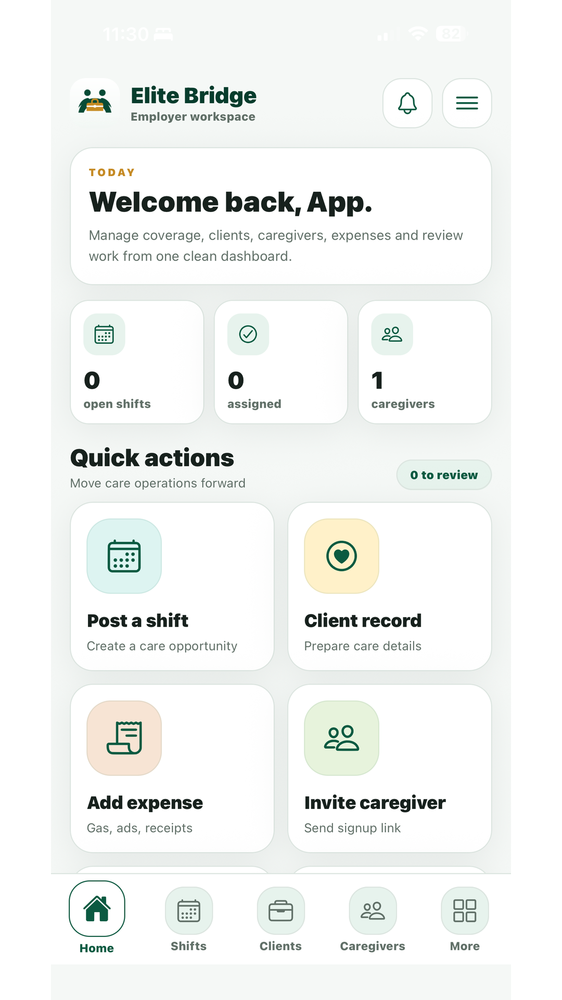
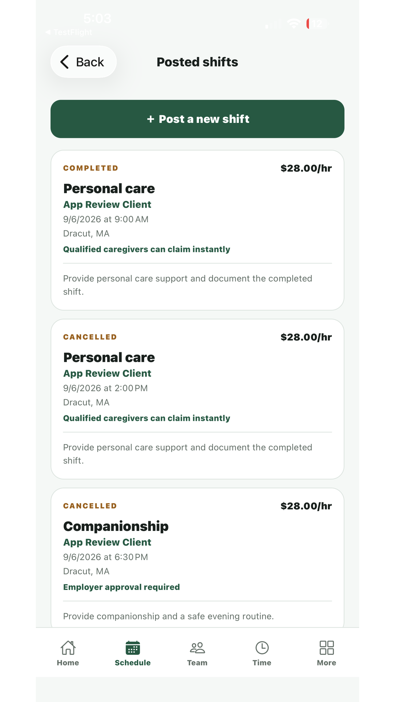
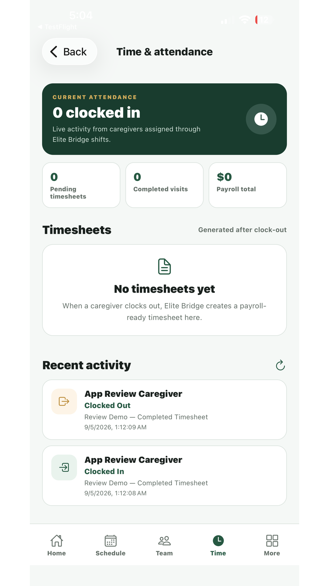

# Hi, I'm Evans Saitoti

**Software developer & founder**

I'm an experienced software developer building websites, web and mobile applications, and business systems. I turn ideas and complex requirements into practical software across industries.

## Featured project: Elite Bridge

A staffing and care coordination platform with management web dashboards and two mobile experiences: **Elite Work** and **Elite Care**.

- **Scheduling:** weekly coverage views and caregiver assignments.
- **Attendance:** timekeeping, correction requests, and authorized review.
- **Operations:** timesheets, invoices, and staff coordination.
- **Engineering:** organization access controls, auditable corrections, and notification tracking.

## Product showcase

Selected mobile review-build screens using app-review/demo records. These captures show an earlier review build; layouts and features may differ from the current release. Displayed counts and rates are demo values, not business results.

  
  
  

**Dashboard · Shift management · Time and attendance**

[Read the Elite Bridge case study →](case-studies/elite-bridge.md)

The case study covers the product, my role, architecture, engineering decisions, and verification approach. Application source code remains private.
