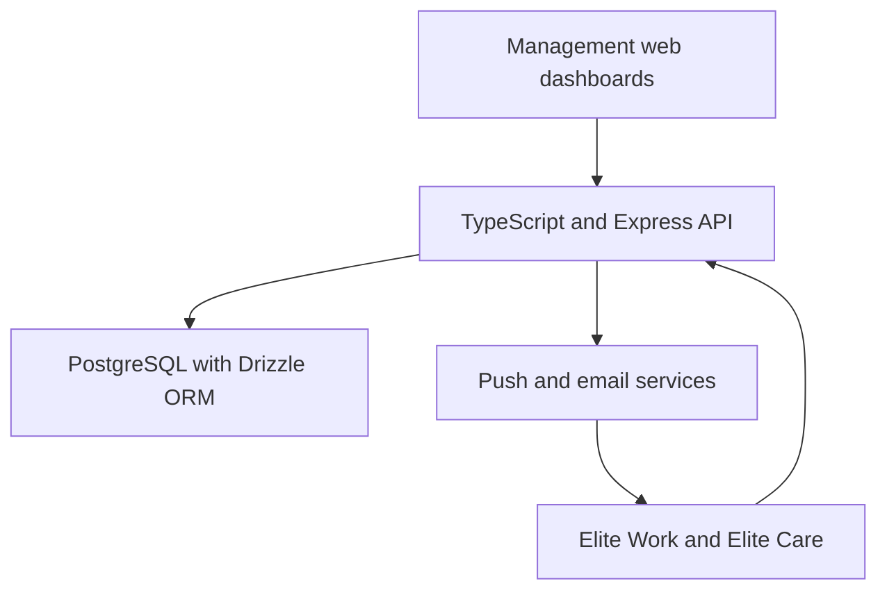

# Elite Bridge — staffing and care coordination

**A web and mobile platform built around the day-to-day work of running a staffing business.**

| Project | Details |
| --- | --- |
| Product | Elite Bridge |
| Role | Founder and product developer |
| Interfaces | Management web dashboards, Elite Work, and Elite Care |
| Focus | Scheduling, caregiver coordination, attendance, timesheets, and billing workflows |
| Source code | Private |

## The problem

Staffing a care visit involves more than assigning a name to a time slot. Managers need to see coverage gaps, communicate changes, review attendance, and carry approved hours into billing workflows. Caregivers need a clear view of their assignments and a practical way to record time and respond to changes.

Elite Bridge brings these connected tasks into one product, informed by the operational needs of Elite Bridge Staffing.

## My role

I define product requirements from real business workflows, prioritize features, and guide development across the web and mobile experiences. My work includes reviewing behavior, testing workflows, and refining the product as operational needs change. Development uses AI-assisted tools alongside documentation, code review, and testing.

## Product experience

| User | Core workflow |
| --- | --- |
| Owner and management team | Review weekly coverage, schedule work, invite staff, and manage access |
| Caregiver | View assigned shifts, record attendance, receive notifications, and request time corrections |
| Authorized office staff | Review timesheets, manage invoices, and prepare operational exports |

The web dashboard supports detailed management tasks. The mobile apps focus on the actions staff and managers need while away from a desk.

## Architecture

The diagram summarizes the core staffing workflow rather than every service in the codebase.

| Layer | Technologies used |
| --- | --- |
| Web interfaces | HTML, CSS, and JavaScript |
| Mobile applications | React Native, Expo, and TypeScript |
| Core backend | Node.js, Express, and TypeScript |
| Data access | PostgreSQL and Drizzle ORM |
| Identity and validation | JWT authentication, role checks, and Zod |
| Automated checks | Vitest, JSDOM, and isolated database tests |

## Engineering decisions

### 1. Enforce organization boundaries in the backend

A shared application must keep each organization's records separate. Backend authorization combines user identity, organization membership, and role checks. Hiding an administrative button is only a presentation choice; access decisions also belong on the server.

### 2. Preserve evidence when correcting attendance

A missed clock-in should not silently replace the original record. The correction workflow captures requested times and a reason, requires authorized review, and retains the original attendance evidence. Stale approvals are rejected so that a reviewer cannot overwrite a record that changed while they were reviewing it.

### 3. Treat notifications as a workflow with uncertain outcomes

A push provider accepting a request does not establish that the caregiver saw it. The implementation records send-attempt outcomes separately from user acknowledgment. Reminder deduplication helps avoid repeated alerts when a scheduler runs again.

### 4. Handle schedules as both instants and calendar dates

Overnight visits and daylight-saving changes complicate scheduling. Reminder comparisons use UTC instants, while the management board organizes visits by the relevant local calendar day. This separates elapsed-time calculations from how managers read their schedule.

## Verification approach

The repository includes automated scenarios for:

- Organization isolation and role-based permissions.
- Overnight scheduling and weekly navigation.
- Reminder timing, deduplication, and canceled or unassigned work.
- Attendance corrections, audit records, and stale-review rejection.
- Notification outcomes without claiming handset delivery.

These describe implemented test coverage, not a claim that every release or integration has passed an independent audit.

## Outcome and ongoing work

Elite Bridge connects scheduling, attendance review, and office workflows across web and mobile interfaces. Its value can be demonstrated through complete user journeys, such as scheduling a visit, recording attendance, and reviewing a correction.

Development is ongoing. Feature availability can differ between web deployments and installed mobile versions. The expanded team messaging workspace is separate work in progress and is not presented here as a released feature.

This case study makes no unverified claims about time savings, user counts, or compliance certification. Project source code and operational records remain private.

[Back to my profile](../README.md)
